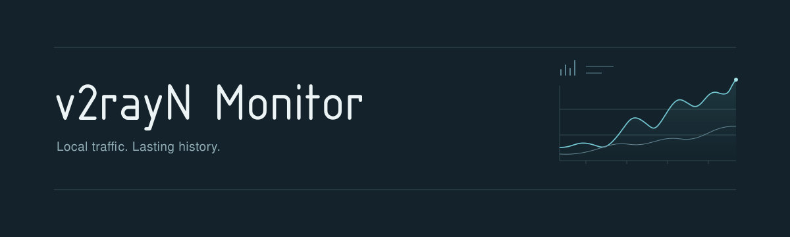

# v2rayN Monitor

以 **v2rayN 本机流量**为主来源的 Windows 托盘统计工具。关闭浏览器后仍持续采集；历史独立保存在本机 SQLite，支持按节点查看日、周、月、年趋势。

> **v0.1.1 修复版。** 在 `v0.1.0` 基础上整合日期默认分桶和重叠 CSV 增量导入，下载资产与实际发布状态以 GitHub Releases 为准。目标环境是 Windows x64、v2rayN **7.25.1 + Xray 普通单节点**。2026-10-13 用户确认相关修复已处理并授权发布，属于基于此前预览使用的整体确认，不代表所有协议、设备与切换时序逐项经过实测。统一图标已有构建和资源检查，Windows 实机目视记录仍未补充。源码核对、合成测试和实机证据分开记录，不能当作计费凭证。

## 能力分级

正式 Release 按以下三档提供独立下载包，包名标明版本号与档位；当前尚未发布这组三档新包。开发预览及实机验收进度见 [支持矩阵](docs/compatibility.md) 和 [当前状态](docs/STATUS.md)。

| 分级 | 普通流量统计 | 所需核心 | 独立探测计量 |
|---|---|---|---|
| 基础版 | v2rayN 使用原生 Xray 时的流量统计 | 保留原 Xray，读取已启用的原生统计接口 | 可选扩展，不要求启用 |
| 完整版 | 在基础版上增加 sing-box，覆盖当前支持的 Xray、sing-box 及其已支持模式 | Xray 保持原生；另外下载并安装启用 V2Ray API 及相应统计能力的配套 `sing-box-client.exe`；多出站／策略组还需成员统计能力 | 可选扩展，不作为完整版验收前置 |
| 扩展版 | 保留普通流量统计，按需增加内部探测的独立计量 | sing-box 使用带探测计数的配套核心；Xray 使用经过精确核验的探测实验核心 | 两种核心分别启用，字节口径和覆盖边界单独说明 |

流量探测的独立计量属于 S5.8 可选扩展，不作为 #15 / #18 普通流量统计的收口条件。这里的「全部内核」指当前支持的 Xray 和 sing-box，不扩大到未支持的 TUN、代理链、任意配置来源或插件。

当前 sing-box `test.5` 已将普通统计和探测扩展放在同一包中，能力分级不要求重新替换核心。完整版可以保留原生 Xray；只有需要 Xray 的独立探测字节时，才另行接入修改后的 Xray。已有探测能力和历史保留；分级不改变账本版本、启动模式或现有安装。

三档共用 Monitor 源码和软件版本号，发布资产分别为 `v2rayn-monitor-<version>-basic-windows-x64.zip`、`v2rayn-monitor-<version>-full-windows-x64.zip`、`v2rayn-monitor-<version>-extended-windows-x64.zip`。基础包提供 Monitor；完整版另提供配套 sing-box 核心；扩展版再提供探测能力及配套 Xray 实验核心。每包分别列明内容、核心版本、SHA256、许可与源码／补丁依据；配套核心由用户按说明安装，不自动覆盖正在运行的核心。分级与发包约定不等于本轮已经构建或发布三档资产。

## 已实现的主流程

- WinForms 托盘常驻、单数据目录单实例、系统浏览器本地页面；便携包无需 WebView2
- 只读发现 Xray 进程与动态 metrics 端口，以进程代次、有效配置和节点身份核对归属
- 原始整数字节记账；第一条只建基线，切换/重启/未知边界留缺口，读取失败不写成零
- SQLite 原子游标与分钟历史，节点改名保留历史，日/周/月/年汇总、排行、分页、CSV 导出
- 回环监听、一次性打开链接、短期会话、Host/Origin 校验；无云端、无遥测、无 CDN
- 可选六列服务商 CSV 预览与事务导入，独立账本、同文件防重；不影响本机采集
- 完全合成的演示数据与针对性回归测试

已发布的 v0.1.1 不支持 sing-box、TUN、策略组、多跳链、自定义核心配置或多个 v2rayN 实例的精确统计。开发预览的额外能力按上述分级及支持矩阵说明。复杂或不确定配置会显示原因并暂停归属，不猜测出口。没有签名、安装器或自动更新器。

## 使用

[快速开始、统计设置与故障排查](docs/QUICKSTART.md) · [支持边界](docs/compatibility.md) · [当前验证状态](docs/STATUS.md)

版本包以 [GitHub Releases](https://github.com/lengmh/v2rayN-Monitor/releases) 页面及其 SHA256 为准；开发预览仍可在对应 Actions 运行的 `windows-x64-preview` artifact 下载。解压到可写目录，运行 `V2rayN-Monitor.exe`，选择包含 `guiConfigs` 和 `binConfigs` 的 v2rayN **数据根目录**。不需要导入 CSV。

默认数据位于 `%LOCALAPPDATA%\V2rayN-Monitor\data`。`--demo` 使用独立演示目录，不连接真实核心；`--data-dir "D:\MonitorData"` 可显式选择 Monitor 历史目录。托盘菜单可手动启用当前用户登录时启动。

## 开发与测试

需要 .NET 10 SDK、Node.js 24 和 Python 3：

```powershell
cd web
npm ci
npm test
npm run build
cd ..
python scripts/check_plan.py
dotnet build V2rayNMonitor.sln -c Release
dotnet test tests/Core.Tests/Core.Tests.csproj -c Release
dotnet test tests/Server.Tests/Server.Tests.csproj -c Release
dotnet publish src/Host/Host.csproj -c Release -r win-x64 --self-contained true -o artifacts/win-x64
```

Linux/macOS 可验证核心记账与本地 API，并运行合成演示（不能采集 Windows v2rayN）：

```sh
dotnet run --project src/Demo -- /tmp/v2rayn-monitor-demo
```

控制台提供两分钟有效、一次性演示链接，不要分享。真实应用从托盘打开，无需复制令牌。

## 数据口径与限制

本机上传/下载来自 Xray `proxy` outbound 的原始累计值，不与 direct/inbound 相加，也不等同于网卡线速或服务商扣费。按 v2rayN 活动配置归属，身份采用实例与 IndexId；连接参数相同的不同配置分别保存历史，名称仅供展示。此口径不承诺从核心侧独立辨别连接特征完全相同的逻辑配置。切换先建立新基线，无法确定的边界增量保留缺口。

长期保存 UTC 分钟记录，短采样按时间比例守恒分配；分钟内分布是近似。查询边界精度为分钟，日界线按设置的时区、周从周一开始。连续会话长缺口恢复的总量单列“未分时”，不填入日期图表。缺口和未观察时段不能当作已证实的零流量。

服务商原始量须为非负整数字节；计费量和倍率使用精确非负十进制数值。计费量以 CSV 为准，不用原始量乘倍率重算，也不取整。预览及批次列表显示精确值；零倍率仍可能有原始量。十进制值及批次总计须能以 96 位系数、最多 28 位小数无损表示，超限整批拒绝。每文件最多 4 MB、50,000 条数据记录（不含表头）。同一来源按重复导出快照比较规范化计费行（UTC 时间、节点名、倍率、原始量、精确计费量）及出现次数，跳过已有记录、只导入新增部分，保留文件内合法重复；traffic 显示文本不参与匹配。预览显示文件/新增/跳过数量和新增精确总量，确认提交时重新核对。相同时间和名称的计费字段变化且无法确认是否修订时提示冲突，不覆盖旧记录。这是约定快照语义下的有限去重，不宣称无记录 ID 时的普适精确识别。仅展示最近 200 批导入记录，无批次撤销或本机节点自动匹配。

## 项目资料与隐私

[8 阶段/33 节点计划](docs/development-plan.md) · [架构](docs/architecture.md) · [固定源码依据](docs/sources.md) · [开发约定](AGENTS.md) · [安全边界](SECURITY.md)

只提交原创实现和完全合成测试。真实配置、订阅、密码、节点明细、数据库、CSV 和运行日志不得上传仓库。运行不修改 v2rayN 配置、不重启核心、不调用 reset 统计操作。原创资料与代码采用 [MIT](LICENSE)。本项目并非 v2rayN、Xray、sing-box 或 TrafficMonitor 官方组件。
